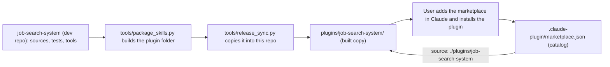

# Architecture

A map of every part of this repo: what it is, what it does and why it is needed. This repo is a Claude plugin marketplace. It is a catalog plus the plugin files the catalog points to. Nothing runs from here, and it holds no personal data.

Based on the repo contents on 2026-11-19. The plugin folder was compared with `plugins/core/` in the `job-search-system` dev repo on the same date: the files are identical except `LICENSE`, which here has the licensor name filled in.

## The big picture

Two repos play two roles:

- **The dev repo** (`job-search-system`) holds the sources, tests and maintainer tools. Work happens there.
- **This repo** is the release copy. It holds the catalog and a built copy of each plugin. Users add this repo as a marketplace in Claude, and Claude reads the catalog and installs the plugin from `plugins/`.

Edit plugin content in the dev repo, never here. A change made only here is overwritten by the next release sync.

## Repo root

| Artifact | What it does | Why it is needed |
| --- | --- | --- |
| `.claude-plugin/marketplace.json` | The catalog. Names the marketplace (`simply-productive-software`), its owner, and lists each plugin with its name, `source` path and description | Claude requires it to treat the repo as a marketplace. The marketplace page shows the description from here, not from `plugin.json` |
| `README.md` | Front page for users: what the marketplace is, the plugin table, how to add the marketplace in Claude (web, desktop and Claude Code), what data the plugin touches, and contact | The first thing a user sees. It states the early-testing status and that nothing here holds personal data |
| `LICENSE` | The Job Search System beta license, with the licensor name and contact filled in | Sets what users may do with the files in this repo. The license text must be present in the repo that users install from |
| `plugins/` | One folder per plugin. The catalog's `source` paths point into it | Keeps each plugin self-contained so the catalog can list more than one |
| `docs/ARCHITECTURE.md` | This file | Lets a maintainer find any file and learn why it exists |

## `plugins/job-search-system/`: the plugin

This folder is a built copy of the dev repo's Core plugin. Do not edit it by hand.

| Artifact | What it does | Why it is needed |
| --- | --- | --- |
| `.claude-plugin/plugin.json` | The plugin manifest: name, display name (`Job Search System`), version, license pointer, description and keywords | Claude needs it to install the folder as a plugin. The version here is what tells an installed copy that an update exists |
| `LICENSE` | The license, copied into the plugin at build time with the licensor name and contact filled in | A marketplace install copies only the plugin folder, so the license has to be inside it |
| `README.md` | What the plugin does, its requirements (Google Drive and Google Sheets connectors) and the use-at-your-own-risk note | The plugin's own front page. It says nothing personal is stored in the plugin |
| `skills/onboard/SKILL.md` | The onboard skill: a six-step setup that creates the user's Drive folders and tracker sheet and builds their profile | The entry point for a new user. It produces what the other skills read |
| `skills/onboard/references/` | `step2-storage.md` through `step6-settings.md`: storage, career facts, wants, voice and output settings | Each step's detailed instructions, loaded only when that step runs |
| `skills/apply/SKILL.md` | The apply skill: chooses draft or log mode and finds the profile and tracker | The daily-use skill. It takes one chosen job from posting to logged application |
| `skills/apply/references/` | `draft.md` (posting, extract, resume, cover letter, claim map, review, save) and `log.md` (applied, skipped, parked, closed, outcomes) | The two modes of the apply skill, loaded on demand |
| `skills/review/SKILL.md` | The review skill: runs the code checks and an independent reviewer, and returns blockers and notes | A draft cannot be marked Ready until it passes. The user can also run it on a draft they edited |
| `skills/review/references/reviewer-brief.md` | The instructions for the reviewer, which sees only the drafts, the posting and the profile files | The reviewer must be independent of the drafter, so its brief stands alone |

### Generated copies inside each skill

Each skill is self-contained because an installed skill may have no access to anything outside its own folder. Each of these folders holds an `_GENERATED.txt` saying not to edit it. They are made by `tools/sync_shared.py` in the dev repo.

| Artifact | What it does | Why it is needed |
| --- | --- | --- |
| `skills/{onboard,apply,review}/shared/` | Shared rules and schemas: profile and tracker handling, untrusted-input rules, writing rules, cover letter guide, skill categories, HTML layout, the experienced-candidate module, three JSON schemas, `tracker-schema.yaml` and `default-settings.yaml` | Every skill reads the same rules from inside its own folder |
| `skills/{onboard,apply,review}/checks/` | The Python check scripts (`run_checks.py`, `checkers.py`, `lib.py`, `validate.py`, `dedupe_key.py`), `requirements.txt`, the age-phrase list and a README | The code checks catch what a model can miss: numbers, dates, employers, skill labels, contact details, banned phrases, spelling and PDF text. Tests are left out of the build |
| `skills/onboard/templates/profile/` | The eight starting files for the user's Profile folder: `profile.yaml`, `facts.md`, `wants.md`, `voice.md`, `stories.md`, `answers.md`, `sources.yaml`, `settings.yaml` | Onboarding copies these into the user's Drive and fills them in with them |

## Where data lives

| Place | Holds | Why it is not in this repo |
| --- | --- | --- |
| The user's Google Drive | One system folder with Profile, Applications and a tracker sheet | Everything personal stays in the user's own account. The plugin only gets there through connectors the user authorizes |

## Release process

The full steps are in `tools/README.md` in the dev repo. In short:

1. Merge the change in the dev repo and bump the version in `plugin.json`.
2. Run `tools/release_sync.py` in the dev repo with `--target` set to a clone of this repo, plus `--licensor` and `--contact`. It builds, checks, and replaces `plugins/job-search-system/` here.
3. By hand, make the catalog description in `marketplace.json` match the plugin's description. The sync tool does not edit the catalog.
4. Review the diff here, commit and push to main.
5. In Claude, use Check for updates on the marketplace. A private marketplace does not reliably update on a push alone.

## Rules

- **No personal data.** This repo holds only plugin files and a catalog.
- **Do not edit the plugin folder here.** Fix it in the dev repo and release again.
- **Keep the catalog description and `plugin.json` description the same.** The marketplace page shows the catalog text.
- **Bump the version on every release.** An installed plugin updates only when its version changes.
- **Nothing in the plugin submits applications, sends email or fills in forms.** The user always does that.
